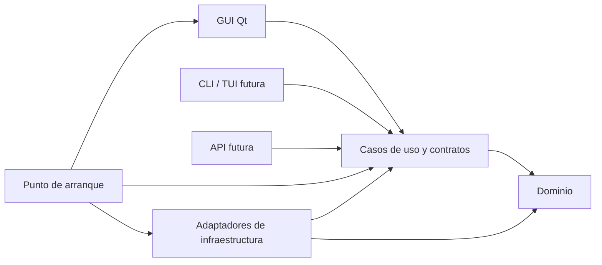

# Arquitectura prevista de Trackfolio

Este documento define la separación que debe conservarse al implementar la aplicación. El repositorio contiene los paquetes reservados y la infraestructura de desarrollo; todavía no implementa operaciones sobre una biblioteca musical.

## Dependencias entre capas

Las dependencias de código apuntan hacia el dominio y los contratos internos. Los casos de uso llaman a adaptadores mediante contratos; el punto de arranque construye los adaptadores y los conecta. Así, la persistencia o la GUI pueden sustituirse sin cambiar las reglas del catálogo.

| Paquete | Responsabilidad prevista | Dependencias permitidas |
| --- | --- | --- |
| `domain` | Entidades, valores, invariantes y reglas musicales | Biblioteca estándar; sin Qt, ORM o acceso a archivos |
| `application` | Casos de uso, contratos de repositorio y acceso a metadatos, resultados y errores de aplicación | Dominio y biblioteca estándar |
| `infrastructure` | SQLite/SQLAlchemy, migraciones Alembic, Mutagen, archivos y directorios de usuario | Contratos internos y librerías técnicas |
| `interfaces/gui` | Widgets, presentación y traducción de eventos del usuario | Casos de uso y Qt; adaptadores conectados desde el arranque |
| `resources` | Recursos visuales incluidos en el paquete | Acceso mediante recursos de Python/Qt al implementar la GUI |

Los contratos públicos de dominio y aplicación no expondrán `QObject`, señales Qt, widgets, modelos ORM, sesiones SQLAlchemy ni objetos de Mutagen. Usarán tipos de Python y resultados definidos por la aplicación. La conversión a esos tipos corresponde a cada adaptador.

## GUI y futuras interfaces

La GUI es una capa de presentación: recoge una solicitud, invoca un caso de uso y muestra su resultado o error. No decide las reglas de edición de etiquetas, no construye consultas SQL y no escribe directamente los archivos musicales. Los casos de uso también coordinan las operaciones que necesitan varios adaptadores.

Las tareas largas requerirán una estrategia de ejecución y cancelación que mantenga receptiva la GUI. El contrato de esas tareas deberá ser independiente del bucle de eventos de Qt; su adaptador gráfico traducirá progreso y finalización a la presentación.

Una futura CLI/TUI utilizará los mismos casos de uso. Para una biblioteca remota, el servidor ejecutará los casos de uso junto a su música y su almacenamiento; el frontend web consumirá su API. Autenticación, protocolo, concurrencia y despliegue se diseñarán cuando se implemente esa interfaz. Esta preparación no añade un servidor.

## Persistencia y rutas

SQLAlchemy será el adaptador de persistencia para SQLite y Alembic gestionará la evolución de su esquema. El esquema y las migraciones se crearán cuando exista el modelo del catálogo. La transacción de la base de datos no cubre automáticamente la edición de archivos musicales: los futuros casos de uso deberán definir cómo detectar, comunicar y recuperar fallos parciales.

Se usarán `pathlib` y una raíz de biblioteca configurable. Una pista se identificará mediante su biblioteca y una ruta relativa a esa raíz, evitando fijar `/home/...`, letras de unidad o montajes personales. Cada equipo podrá asociar la biblioteca a una ubicación distinta.

`platformdirs` ubicará la configuración, caché y base de datos en directorios del usuario adecuados a cada sistema. La música y los datos locales no se guardarán en el repositorio. Trasladar el código mediante Git y trasladar una biblioteca musical serán operaciones distintas.

## Apariencia compartida

La GUI prevista usará Qt Widgets con estilo **Fusion** seleccionado explícitamente, paleta, estilos, fuentes e iconos propios incluidos como recursos. Los diálogos que formen parte del diseño compartido deberán usar implementaciones Qt consistentes entre plataformas. [Estilos disponibles en Qt](https://doc.qt.io/qt-6/qstylefactory.html).

La validación visual comparará controles, colores, tipografía, iconos y distribución. El rasterizado y el escalado DPI pueden variar entre sistemas. Fusion no controla el marco y la barra de título del sistema: si también deben ser idénticos, se necesitarán decoraciones propias y pruebas de manejo de ventanas y accesibilidad.

## Estrategia de comprobación

Las reglas del dominio y los casos de uso se probarán sin Qt ni SQLite, usando adaptadores de prueba para sus contratos. Las pruebas de infraestructura usarán bases de datos temporales y archivos de prueba controlados. Las pruebas de GUI comprobarán la presentación y la integración con esos casos de uso.

Durante la preparación, las comprobaciones cubren reconstrucción del entorno, límites entre paquetes, disponibilidad de dependencias, funcionamiento de SQLite y arranque mínimo de Qt. La prueba `offscreen` se registra por separado de las pruebas de escritorio real.
