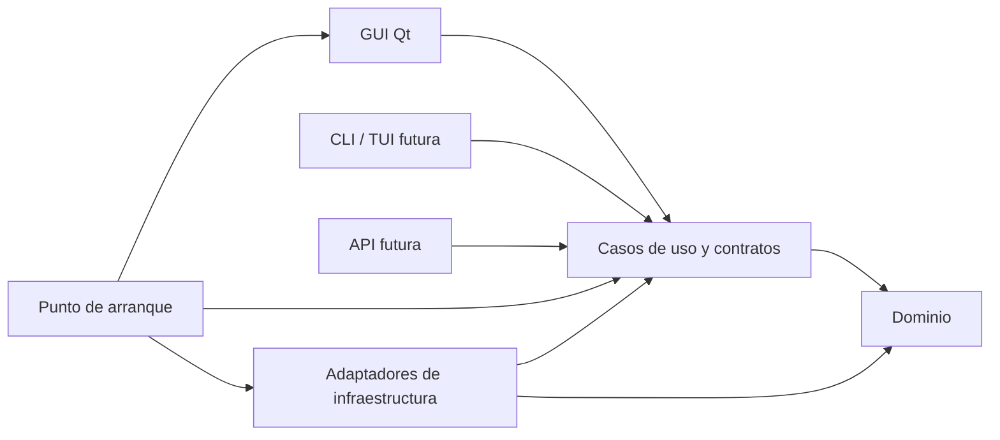

# Arquitectura de Trackfolio

El núcleo importa y consulta metadatos de archivos FLAC/MP3 mediante contratos independientes de Qt. La primera GUI muestra el catálogo mediante estos contratos; las interfaces CLI/TUI y de servidor se mantienen como posibilidades futuras.

## Dependencias entre capas

Las dependencias de código apuntan hacia el dominio y los contratos internos. Los casos de uso llaman a adaptadores mediante contratos; el punto de arranque construye los adaptadores y los conecta. Así, la persistencia o la GUI pueden sustituirse sin cambiar las reglas del catálogo.

| Paquete | Responsabilidad prevista | Dependencias permitidas |
| --- | --- | --- |
| `domain` | Entidades, valores, invariantes y reglas musicales | Biblioteca estándar; sin Qt, ORM o acceso a archivos |
| `application` | Casos de uso, contratos de repositorio y acceso a metadatos, resultados y errores de aplicación | Dominio y biblioteca estándar |
| `infrastructure` | SQLite/SQLAlchemy, migraciones Alembic, Mutagen, archivos y directorios de usuario | Contratos internos y librerías técnicas |
| `interfaces/gui` | Widgets, presentación y traducción de eventos del usuario | Casos de uso y Qt; adaptadores conectados desde el arranque |
| `resources` | Recursos visuales incluidos en el paquete | Acceso mediante recursos de Python/Qt al implementar la GUI |

Los contratos públicos de dominio y aplicación no expondrán `QObject`, señales Qt, widgets, modelos ORM, sesiones SQLAlchemy ni objetos de Mutagen. Usarán tipos de Python y resultados definidos por la aplicación. La conversión a esos tipos corresponde a cada adaptador.

## GUI y futuras interfaces

La GUI es una capa de presentación: recoge una solicitud, invoca un caso de uso y muestra su resultado o error. No decide las reglas de edición de etiquetas, no construye consultas SQL y no escribe directamente los archivos musicales. Los casos de uso también coordinan las operaciones que necesitan varios adaptadores.

El controlador gráfico ejecuta consultas mediante un pool de tareas Qt y sólo modifica widgets en el hilo gráfico. Usa identificadores de solicitud para descartar resultados de selecciones o catálogos anteriores. Las conexiones SQLite se obtienen por operación; el cierre espera a las consultas activas antes de liberar las sesiones y los objetos Qt. Los casos de uso permanecen independientes del bucle de eventos.

`ImportCatalog` coordina una carpeta con contratos de exploración, lectura y destino de
escritura. Solicitud, progreso, incidencias e informe son dataclasses inmutables Python.
Los adaptadores convierten errores técnicos a errores de aplicación. La exploración
selecciona rutas FLAC/MP3; la lectura y escritura son secuenciales, con una transacción
por archivo y resultados ligeros de creación/actualización sin recargar BLOBs.

La GUI invalida y termina sus consultas pendientes antes de retirar el lector e iniciar
el escritor. Durante la importación deshabilita cambios de catálogo y selección; progreso
y resultados llegan mediante señales encoladas. La cancelación es cooperativa y conserva
las escrituras confirmadas. Al terminar libera el escritor y reabre el lector, conservando
la selección cuando actualiza el mismo catálogo. El cierre de ventana y las solicitudes
normales de salida de Qt mantienen activo el bucle de eventos hasta liberar el trabajador;
la disposición final garantiza que sus objetos Qt no se destruyen antes de ese cierre.

Una futura CLI/TUI utilizará los mismos casos de uso. Para una biblioteca remota, el servidor ejecutará los casos de uso junto a su música y su almacenamiento; el frontend web consumirá su API. Autenticación, protocolo, concurrencia y despliegue se diseñarán cuando se implemente esa interfaz. Esta preparación no añade un servidor.

## Persistencia y rutas

SQLAlchemy implementa el repositorio SQLite y Alembic gestiona su esquema. El snapshot
`migrations/initial_schema.py` y la revisión `001_initial` permanecen inmutables.
`infrastructure/schema.py` copia esa metadata y define el esquema vigente, con el índice
único de nombres de artista añadido por `002_unique_artists`. Las exportaciones SQL
histórica y vigente se generan desde la misma cadena de Alembic.

`schema_validation.py` reconoce ambos esquemas para lectura y exige el vigente para
escritura, incluida la unicidad global y exacta. El respaldo SQLite y la migración
transaccional se comparten entre el destino de importación, el script individual y el
comando de actualización. El escritor reserva el catálogo antes del respaldo y revalida
su revisión bajo ese bloqueo. Abrir para consultar nunca migra el archivo.

El repositorio resuelve artistas por nombre exacto en todo el catálogo, con inserciones
que reutilizan el índice único. El contexto del álbum decide su agrupación, pero no la
identidad del artista. `ImportAudio`, `GetTrack` y `ListTracks` usan contratos de repositorio
y dataclasses de dominio; el lector Mutagen y el repositorio SQLAlchemy son adaptadores
intercambiables. Consulta el [modelo y sus reglas de importación](database.md).

La importación guarda cada archivo en una transacción y no modifica la música. La transacción de la base de datos no cubre automáticamente la edición de archivos musicales: los futuros casos de uso deberán definir cómo detectar, comunicar y recuperar fallos parciales.

Se usan `pathlib`, una raíz de biblioteca configurable y rutas relativas para los archivos. La ruta identifica la ubicación importada, no la identidad musical de una grabación. El esquema separa pistas y archivos, pero el importador inicial crea una pista por cada archivo nuevo; la identificación entre ediciones y la reasignación de raíces al mover una biblioteca quedan pendientes.

`platformdirs` ubicará la configuración, caché y base de datos en directorios del usuario adecuados a cada sistema. Durante la revisión se utiliza explícitamente `data/database.tfo`, excluido de Git. La música y los datos locales no se guardan en el repositorio. Trasladar el código mediante Git y trasladar una biblioteca musical son operaciones distintas.

## Apariencia compartida

La GUI usa Qt Widgets con **Fusion** explícito, paleta y estilos compartidos, Inter 4.1 empaquetada con su licencia e iconos SVG propios. Los recursos se cargan con `importlib.resources`; el diálogo de apertura es Qt sin modo nativo. [Estilos disponibles en Qt](https://doc.qt.io/qt-6.11/qstylefactory.html).

La ventana incluye barra de título y controles Qt propios, con operaciones de movimiento y redimensionado del sistema y alternativas según backend. Si un compositor Wayland rechaza esas operaciones, se usa el marco nativo para mantener la ventana operativa. La validación visual compara controles, colores, tipografía, iconos y distribución; el rasterizado y el escalado DPI pueden variar entre sistemas.

## Estrategia de comprobación

Las reglas del dominio y los casos de uso se probarán sin Qt ni SQLite, usando adaptadores de prueba para sus contratos. Las pruebas de infraestructura usarán bases de datos temporales y archivos de prueba controlados. Las pruebas de GUI comprobarán la presentación y la integración con esos casos de uso.

Las comprobaciones cubren reconstrucción del entorno, límites entre paquetes, disponibilidad de dependencias, migraciones, lectura de contenedores FLAC/MP3 sintéticos, importación y consulta mediante SQLite, y arranque mínimo de Qt. La prueba `offscreen` se registra por separado de las pruebas de escritorio real.
