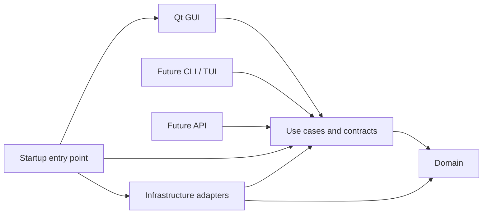

# Trackfolio architecture

The core imports, queries and edits a FLAC/MP3 file catalog and writes its tags through Qt-independent contracts. The GUI uses these contracts; CLI/TUI and server interfaces remain future possibilities.

## Dependencies between layers

Code dependencies point toward the domain and internal contracts. Use cases call adapters through contracts; the startup entry point constructs and connects the adapters. Persistence or the GUI can therefore be replaced without changing catalog rules.

| Package | Intended responsibility | Allowed dependencies |
| --- | --- | --- |
| `domain` | Entities, values, invariants and music rules | Standard library; no Qt, ORM or file access |
| `application` | Use cases, repository and metadata access contracts, application results and errors | Domain and standard library |
| `infrastructure` | SQLite/SQLAlchemy, Alembic migrations, Mutagen, files and user directories | Internal contracts and technical libraries |
| `interfaces/gui` | Widgets, presentation and translation of user events | Use cases and Qt; adapters wired at startup |
| `resources` | Visual assets included in the package | Access through Python/Qt resources when implementing the GUI |

Public domain and application contracts must not expose `QObject`, Qt signals, widgets, ORM models, SQLAlchemy sessions or Mutagen objects. They use Python types and application-defined results. Each adapter converts its data into those types.

## GUI and future interfaces

The GUI is a presentation layer: it collects a request, invokes a use case and displays its result or error. It does not decide tag editing rules, build SQL queries or write music files directly. Use cases also coordinate operations requiring multiple adapters.

The graphical controller executes queries through a Qt task pool and only modifies widgets on the GUI thread. Request identifiers discard results from previous selections or catalogs. SQLite connections are obtained per operation; shutdown waits for active queries before releasing sessions and Qt objects. Use cases remain independent of the event loop.

`ImportCatalog` coordinates a folder through scanning, reading and write-destination contracts. Requests, progress, issues and reports are immutable Python dataclasses. Adapters convert technical errors into application errors. Scanning selects FLAC/MP3 paths; reading and writing are sequential, with one transaction per file and lightweight created/updated results without reloading BLOBs.

The GUI invalidates and finishes pending queries before retiring the reader and starting the writer. During import it disables catalog and selection changes; progress and results arrive through queued signals. Cancellation is cooperative and preserves confirmed writes. At completion it releases the writer and reopens the reader, retaining selection when updating the same catalog. Window close and normal Qt exit requests keep the event loop active until the worker is released; final disposal ensures Qt objects are not destroyed before shutdown.

A future CLI/TUI will use the same use cases. For a remote library, the server will execute use cases alongside its music and storage; the web frontend will consume its API. Authentication, protocol, concurrency and deployment will be designed when that interface is implemented. This preparation does not add a server.

`GetEditableTrack`, `FindArtists`, `FindGenres` and `UpdateCatalogTrack` use immutable values and an explicit patch of changed fields. Validation belongs in the core; obtaining suggestions or preparing a draft opens readers only. The editing factory opens a SQLite writer only for a valid, effective change.

The controller keeps the snapshot and draft, invalidates earlier queries when editing starts, and waits for workers before saving. Save, cancel and navigation with pending changes are explicit states. A conflict preserves the draft; closing during a write waits for its result. Deferred continuations are discarded if another event started a new operation.

## Persistence and paths

SQLAlchemy implements the SQLite repository and Alembic manages its schema. The `migrations/initial_schema.py` snapshot and `001_initial` revision remain immutable. `infrastructure/schema.py` copies that metadata and defines the current schema, including the unique artist-name index added by `002_unique_artists`. Historical and current SQL exports are generated from the same Alembic chain.

`schema_validation.py` recognizes both schemas for reading and requires the current schema for writing, including global exact-name uniqueness. SQLite backup and transactional migration are shared by the import destination, individual-file script and upgrade command. The writer reserves the catalog before backup and revalidates its revision under that lock. Opening for browsing never migrates the file.

The repository resolves artists by exact name across the catalog, with inserts that reuse the unique index. Album context determines grouping, not artist identity. `ImportAudio`, `GetTrack` and `ListTracks` use repository contracts and domain dataclasses; the Mutagen reader and SQLAlchemy repository are interchangeable adapters. See the [model and import rules](database.md).

The editing adapter compares a musical snapshot under `BEGIN IMMEDIATE` before applying a patch. Names, roles and positions keep the token valid after artist consolidation from `001` to `002`. The same transaction resolves exact artists, copies shared tracks, reassigns albums and obtains the confirmed result. It does not reuse the importer's complete replacement. Technical values, artwork, `raw_tags` and roles unrelated to the edited field are preserved.

Corrections modify SQLite. Reimporting still uses file metadata as its source and replaces catalog corrections while preserving additional roles. Editing adds no tables or dependencies and reuses the backup of older catalogs.

Import saves each file in a transaction and does not modify music. `TagWriteService.execute` calculates all saved differences and performs writing. `PreviewTagWrites` internally prepares the plan against current files without migrations or writes. `WriteTagWrites` sequentially coordinates backup, editing a copy, verification, publication and partial SQLite confirmation. `domain/tag_write.py` defines requests, snapshots, differences, states and reports; application contracts do not depend on Mutagen, SQLAlchemy or Qt.

`infrastructure/tag_write.py` preserves alias families and ID3 version, verifies all semantic values and unrelated metadata, and compares FLAC/MPEG audio hashes. `tag_write_files.py` provides exclusive copies, full fingerprints, local replacement and synchronized JSON logs in the user's data directory. After complete batch success and persisted confirmation, it removes the entire `.trackfolio-backups` directory in every affected folder; errors or cancellation retain copies. Cleanup failures appear in the result and available paths are updated. The post-write hash is recorded before replacement so an interrupted publication can be recognized. `tag_write_catalog.py` compares the musical snapshot and `raw_tags` in a transaction; it confirms only observations and the affected physical date, without reimporting or replacing other catalog corrections.

`ReviewTagWrites` inspects the log and hashes. Explicit confirmation can reconcile SQLite and remove a verified, owned temporary file; it never publishes or restores music automatically. Atomicity is per file, not per batch or across music and SQLite. If the file was written but confirmation fails, the report retains **catalog pending** status. The GUI runs preparation and writing in a worker with cooperative cancellation and deferred close. It always displays songs and progress; the two buttons are Close and Write tags. Errors offer report export in a popup. Technical log review remains in the core and has no GUI. See the [plan](tag-write-plan.md) and [format and recovery guide](tag-writing.md).

Paths use `pathlib`, a configurable library root and relative file paths. A path identifies the imported location, not a recording's musical identity. The schema separates tracks and files, but the initial importer creates one track per new file; cross-edition identification and root reassignment when moving a library remain pending.

`platformdirs` locates configuration, cache and databases in suitable per-system user directories. Review explicitly uses `data/database.tfo`, excluded from Git. Music and local data are not stored in the repository. Moving source through Git and moving a music library are separate operations.

## Shared appearance

The GUI uses Qt Widgets with explicit **Fusion**, a shared palette and styles, Inter 4.1 packaged with its license, and original SVG icons. Resources load through `importlib.resources`; the open dialog uses Qt's non-native mode. [Available Qt styles](https://doc.qt.io/qt-6.11/qstylefactory.html).

The window includes a custom Qt title bar and controls, system move/resize operations and backend-specific fallbacks. If a Wayland compositor rejects those operations, the native frame keeps the window usable. Visual validation compares controls, colors, typography, icons and layout; rasterization and DPI scaling may vary across systems.

## Verification strategy

Domain rules and use cases are tested without Qt or SQLite, using test adapters for their contracts. Infrastructure tests use temporary databases and controlled test files. GUI tests check presentation and integration with those use cases.

Checks cover environment reconstruction, package boundaries, dependency availability, migrations, synthetic FLAC/MP3 container reading, SQLite import and queries, and minimal Qt startup. The `offscreen` test is recorded separately from actual desktop tests.
